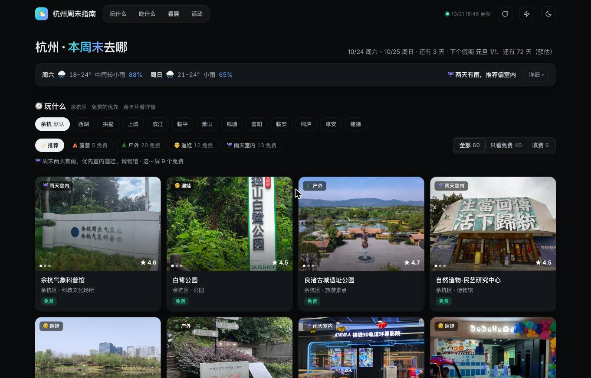
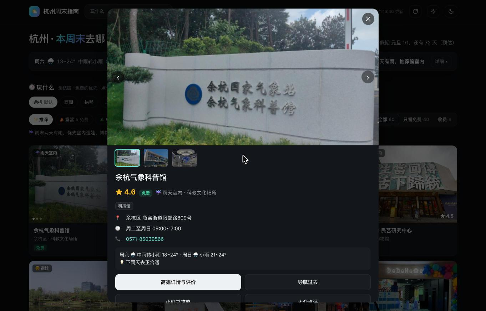

# 🌤 杭州周末指南

> 周末、假期在杭州去哪吃喝玩乐：按区推荐露营、户外、遛娃、雨天室内和吃喝的地方（默认余杭区），加上周末天气、展览、免费讲座、演出玩乐，一页看完

**🌐 在线访问：[https://climb0516.github.io/hz-weekend/](https://climb0516.github.io/hz-weekend/)**

---

## 截图

**玩什么**：按区（默认余杭）推荐露营、户外、遛娃、雨天室内，免费的优先，天气只占一行



**地点详情**：照片、评分、收费 / 免费、地址、营业时间、周末天气建议，一键看高德评价 / 导航 / 小红书 / 大众点评



**吃什么**：高德扫街榜（状元榜·美食 + 极致甄选）榜单式展示，本区上榜的排前面


---

## 功能

- **玩什么**（首屏）
  - 按区切换：余杭（默认）、西湖、拱墅、上城、滨江、临平、萧山、钱塘、富阳、临安、桐庐、淳安、建德，选择会记住
  - 类别：推荐 / 露营 / 户外 / 遛娃 / 雨天室内；「推荐」看周末天气混排（两天都有雨偏室内，否则露营、户外、遛娃）
  - **收费 / 免费标签**：有人均消费 = 收费；公园、绿道、古道、场馆、村头露营点等 = 免费；景区、寺庙、门店类 = 门票待确认。列表按「2 个免费 : 1 个收费」排，可「只看免费」
  - 照片卡：评分、免费 / 收费、上了高德状元榜·景点的挂 🏆 徽章；鼠标在照片上左右移动换图
  - 点卡片弹出详情：大图、评分、人均、地址、营业时间、电话、周末天气建议，按钮「高德详情与评价 / 导航过去 / 小红书攻略 / 大众点评」；网址带 `#place=` 可分享
- **吃什么**：榜单式两列。「扫街榜」= 高德扫街榜网页版的状元榜·美食 + 极致甄选（本区上榜的排前面），带名次、综合分、人均、招牌菜；另有本区高分、人均 ≤ ¥60、咖啡茶饮
- **天气**：只占一行（周六 / 周日温度、天气、降雨概率 + 一句结论），「详细」展开逐小时降雨、10 天预报、生活指数；顶部显示下一个假期（取自拼假攻略站）
- **看展**：横向滑动的海报排；**活动**：免费活动 / 演出玩乐两个标签

- **天气详细**（点「详细」展开）：周六、周日各一张卡（温度、风力、降雨概率、降水量、AQI、8～22 点逐小时降雨、日出日落、出行建议），此刻实况与今日限行、生活指数，10 天预报条；有气象预警时显示红色横幅
- **展览**
  - 筛选：本周末在展（默认）/ 即将撤展（14 天内）/ 新开 / 即将开展 / 免费 / 全部；按场馆筛选
  - 角标：免费、还剩 N 天、新展、M/D 开展、常设
- **免费活动 · 讲座**：浙江图书馆的展览、讲座、阅读推广（带起止时间和馆区），杭州图书馆近 3 周发布的讲座 / 沙龙 / 展览，豆瓣同城标注免费且周末在办的活动；按类别筛选
- **演出 & 玩乐**：豆瓣同城本周末的戏剧、音乐、电影放映、聚会、体验活动，加上秀动 45 天内开演的新演出；周末当天开场的排最前
- 底部：各数据来源抓取状态（正常 / 旧数据 / 失败）
- 右上角：↻ 重新读取数据，⚡ 跳转 GitHub Actions 手动触发抓取，☾ 深浅色；手机适配

---

## 数据来源

| 来源 | 内容 | 说明 |
|---|---|---|
| [高德开放平台 Web 服务](https://lbs.amap.com/api/webservice/guide/api-advanced/newpoisearch) | 各区露营、户外、遛娃、室内、吃喝地点：名称、类型、地址、坐标、评分、人均、营业时间、照片 | 需要 `AMAP_KEY`（仓库 Secrets）；每次运行最多调用 100 次，余杭每天刷新，其余区 5 天轮一遍；只保留有照片的地点，每类最多 30 个、免费的优先占 2/3，写入 `places.json` |
| [高德扫街榜网页版](https://www.amap.com/ranking/hangzhou) | 杭州状元榜·美食 / 极致甄选 / 状元榜·景点 各前 20，名次、综合分、招牌菜；区页用来标注所在区 | 每天检查一次；网页版目前是 2025 年度榜，完整的 2026 榜只在 App 里 |
| [Open-Meteo](https://open-meteo.com) | 10 天逐日 / 逐小时温度、降雨概率、降水量、紫外线、日出日落；PM2.5 | 全球可达，天气数值主力；空气质量兜底 |
| [中国天气网](http://www.weather.com.cn/weather/101210101.shtml) | 实况、7 天中文天气描述与风力、生活指数、气象预警、限行尾号、5 天 AQI 预报 | 页面背后的 d1 接口，需带 Referer |
| [浙江省博物馆](https://www.zjmuseum.com.cn/cn/) | 正在展出的临展：展期、展厅、馆区、海报 | 官网 SPA 背后的 JSON 接口 |
| [浙江美术馆](https://www.zjam.org.cn/Site/Exbition/ExbitionList.aspx?type=1) | 正在展出 + 即将展出 | ASP.NET 静态页，GBK 编码 |
| [中国美术学院美术馆](https://caam.caa.edu.cn/zl/dqzl.htm) | 当前展览 + 展览预告 | 证书链不完整，抓取时跳过校验 |
| [浙江自然博物院](https://www.zmnh.com/) | 最近发布的临展 | 接口没有展期，只显示发布日期 |
| [豆瓣同城](https://www.douban.com/location/hangzhou/events/weekend-all) | 周末各类活动：时间、地点、费用 | 每类最多 3 页；「展览」分类里的 DIY / 沉浸体验归到玩乐 |
| [秀动](https://www.showstart.com/event/list?cityCode=571) | 杭州新开票演出 | 只取 45 天内开演的，常驻演出跳过 |
| [浙江图书馆](https://www.zjlib.cn/) | 预告中 / 报名中 / 进行中的活动 | bff-api 接口，全部免费 |
| [杭州图书馆](https://www.zjhzlib.cn/hdygjz/index.htm) | 讲座、沙龙、展览列表 | 只有标题和发布日期，时间地点在详情页海报里 |

**限制**：
- 市集没有可抓的结构化来源（基本在小红书和公众号），目前只从豆瓣标题里匹配「市集」
- 杭州博物馆、良渚博物院、国家版本馆杭州分馆、天目里没有可用的网页展讯；良渚的特展会通过豆瓣同城出现
- 豆瓣海报校验 Referer，GitHub Pages 上外链会被拒（418），所以活动列表用类别图标代替海报
- 浙江图书馆的海报是一小时过期的签名链接，不显示
- 生活指数和限行尾号是「今天」的，不是周末的
- 某个来源失败时沿用上一次的数据，在底部来源状态里标「旧数据」

---

## 技术架构

```
GitHub Actions（每 3 小时 / 手动 / 修改爬虫后 push）
  ↓ python scraper.py（只用标准库）
  ↓ 天气：Open-Meteo 数值 + 中国天气网中文描述 / 指数 / 预警 / AQI
  ↓ 展览：省博 / 浙美 / 国美 / 自然博物院 / 豆瓣同城，去掉已撤展，同名展保留官方来源
  ↓ 活动：豆瓣同城 / 秀动 / 浙江图书馆 / 杭州图书馆
  ↓ 写入 data.json 并 commit（updated 每次都变 = 心跳，防止定时任务因 60 天不活跃被停用）
       ↓
GitHub Pages（index.html 读取同目录 data.json，筛选、排序、出行建议都在前端完成）
```

### data.json 结构

```
{
  "updated": "2026-10-21T10:48:12+08:00",
  "city": "杭州",
  "weekend": ["2026-10-24", "2026-10-25"],
  "now": { "temp": "19.6", "weather": "阴", "wind": "北风 4级", "humidity": "79%", "aqi": "16", "limit": "3和7", ... },
  "alarms": [ { "type": "暴雨", "level": "黄色", "desc": "...", "time": "..." } ],
  "indices": [ { "key": "ct", "name": "穿衣", "hint": "较舒适", "desc": "建议穿薄外套..." } ],
  "daily": [ { "date": "2026-10-24", "code": 81, "tmax": 22, "tmin": 18, "pop": 90, "rain": 32.2, "uv": 0.2,
               "text": "中雨转小雨", "wind": "东北风", "aqi": 54, "aqi_level": "良", "sunrise": "06:07", "sunset": "17:19" } ],
  "hourly": { "2026-10-24": [ { "h": 8, "t": 19, "pop": 85, "code": 61 } ] },        // 只存周末两天
  "exhibitions": [ { "title": "...", "venue": "浙江美术馆", "hall": "4、5、6号展厅", "start": "2026-09-22", "end": "2026-10-24",
                     "img": "...", "url": "...", "free": true, "fee": "免费", "source": "浙江美术馆" } ],
  "events": [ { "title": "...", "start": "2026-10-24T14:00", "end": "...", "place": "...", "fee": "126.0元起",
                "free": false, "cat": "戏剧", "source": "豆瓣同城", "url": "..." } ],
  "free":   [ { "title": "...", "start": "...", "end": "...", "published": "2026-10-21", "place": "杭州图书馆", "cat": "讲座", ... } ],
  "sources": [ { "id": "zjam", "name": "浙江美术馆", "ok": true, "stale": false, "count": 6, "updated": "..." } ],
  "store": { ... }                                                                   // 天气类来源上一次成功的结果，失败时兜底
}
```

---

## 本地预览

```
python3 scraper.py
python3 -m http.server 8811
# 打开 http://localhost:8811
```

> 豆瓣同城连续请求会限流，爬虫里每页间隔 1.2 秒，本地调试别频繁跑。
