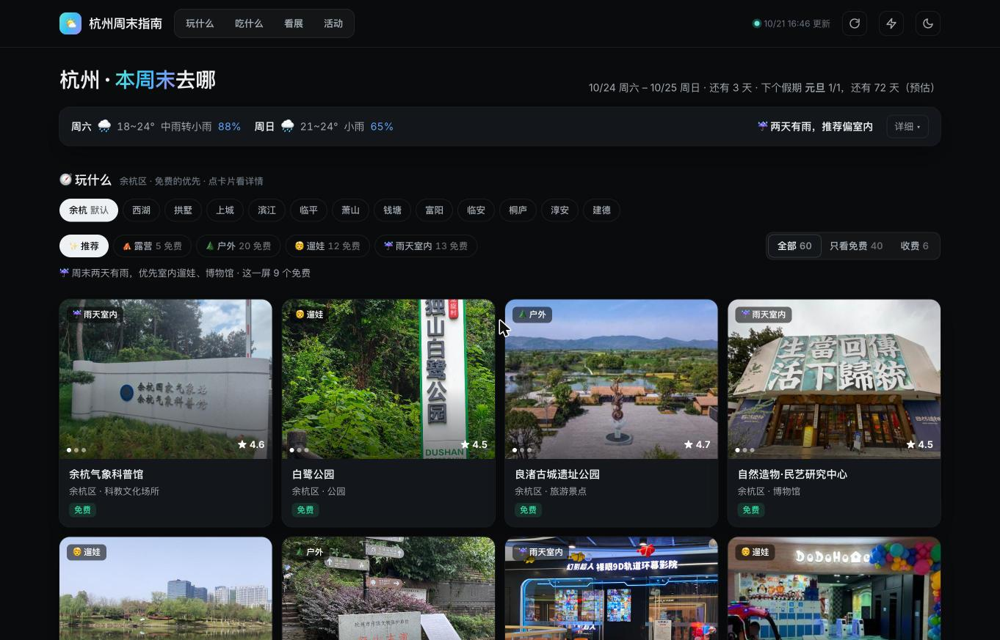
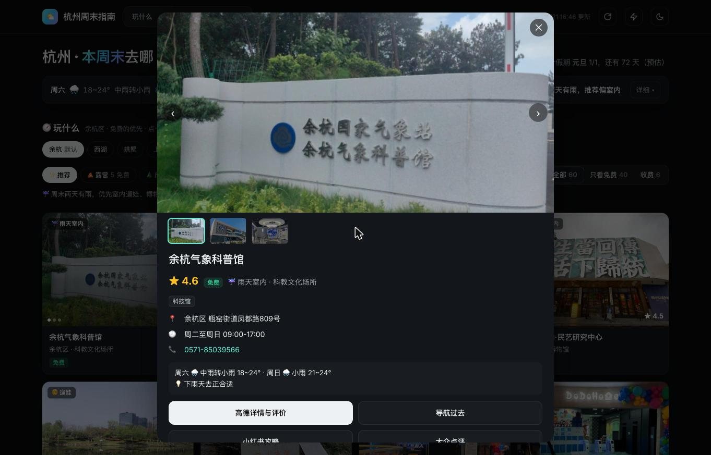

# 🌤 杭州周末指南

> 周末、假期在杭州去哪吃喝玩乐：按区推荐露营、户外、遛娃、雨天室内和吃喝的地方（默认余杭区），加上周末天气、展览、免费讲座、演出玩乐，一页看完

**🌐 在线访问：[https://climb0516.github.io/hz-weekend/](https://climb0516.github.io/hz-weekend/)**

---

## 截图

**玩什么**：按区（默认余杭）推荐露营、户外、遛娃、雨天室内，免费的优先，天气只占一行



**地点详情**：照片、评分、收费 / 免费、地址、营业时间、周末天气建议，一键看高德评价 / 导航 / 小红书 / 大众点评



**吃什么**：高德扫街榜（状元榜·美食 + 极致甄选）榜单式展示，本区上榜的排前面


---

## 功能

- **玩什么**（首屏）
  - 按区切换：余杭（默认）、西湖、拱墅、上城、滨江、临平、萧山、钱塘、富阳、临安、桐庐、淳安、建德，选择会记住
  - 类别：推荐 / 露营 / 户外 / 遛娃 / 雨天室内；「推荐」看周末天气混排（两天都有雨偏室内，否则露营、户外、遛娃）
  - **收费 / 免费标签**：有人均消费 = 收费；公园、绿道、古道、场馆、村头露营点等 = 免费；景区、寺庙、门店类 = 门票待确认。列表按「2 个免费 : 1 个收费」排，可「只看免费」
  - 照片卡：评分、免费 / 收费、上了高德状元榜·景点的挂 🏆 徽章；鼠标在照片上左右移动换图
  - 点卡片弹出详情：大图、评分、人均、地址、营业时间、电话、周末天气建议，按钮「高德详情与评价 / 导航过去 / 小红书攻略 / 大众点评」；网址带 `#place=` 可分享
- **吃什么**：榜单式两列。「扫街榜」= 高德扫街榜网页版的状元榜·美食 + 极致甄选（本区上榜的排前面），带名次、综合分、人均、招牌菜；另有本区高分、人均 ≤ ¥60、咖啡茶饮
- **天气**：只占一行（周六 / 周日温度、天气、降雨概率 + 一句结论），「详细」展开逐小时降雨、10 天预报、生活指数；顶部显示下一个假期（取自拼假攻略站）
- **看展**：横向滑动的海报排；**活动**：免费活动 / 演出玩乐两个标签

- **天气详细**（点「详细」展开）：周六、周日各一张卡（温度、风力、降雨概率、降水量、AQI、8～22 点逐小时降雨、日出日落、出行建议），此刻实况与今日限行、生活指数，10 天预报条；有气象预警时显示红色横幅
- **展览**
  - 筛选：本周末在展（默认）/ 即将撤展（14 天内）/ 新开 / 即将开展 / 免费 / 全部；按场馆筛选
  - 角标：免费、还剩 N 天、新展、M/D 开展、常设
- **免费活动 · 讲座**：浙江图书馆的展览、讲座、阅读推广（带起止时间和馆区），杭州图书馆近 3 周发布的讲座 / 沙龙 / 展览，豆瓣同城标注免费且周末在办的活动；按类别筛选
- **演出 & 玩乐**：豆瓣同城本周末的戏剧、音乐、电影放映、聚会、体验活动，加上秀动 45 天内开演的新演出；周末当天开场的排最前
- 底部：各数据来源抓取状态（正常 / 旧数据 / 失败）
- 右上角：↻ 重新读取数据，⚡ 跳转 GitHub Actions 手动触发抓取，☾ 深浅色；手机适配

---

## 技术架构

```
GitHub Actions（触发：每 3 小时一次 / 手动 dispatch / push 修改 scraper.py 或 workflow）
  ↓ python scraper.py（Python 3.12，只用标准库；Secrets 注入 AMAP_KEY）
  ↓ 天气：Open-Meteo 数值 + 中国天气网中文描述 / 实况 / 指数 / 预警 / 限行 / AQI
  ↓ 展览：省博 / 浙美 / 国美 / 自然博物院 / 豆瓣同城，去掉已撤展，同名展保留官方来源
  ↓ 活动：豆瓣同城 / 秀动 / 浙江图书馆 / 杭州图书馆
  ↓ 写入 data.json
  ↓ places()：高德 POI 搜索（按区 × 类别，每次最多 100 次调用）+ 高德扫街榜网页版 → 写入 places.json
  ↓ git commit data.json + places.json（updated 每次都变 = 心跳）→ push
       ↓
GitHub Pages（index.html 读取 data.json、places.json，另读拼假攻略站的 data.json 显示下个假期）
  ↓ 玩什么 / 吃什么 / 天气 / 看展 / 活动，筛选、排序、出行建议都在前端完成
  ↓ 地点详情弹窗（#place=<高德 POI id>）+ 列表页（#/list?k=places|food&…）
```

---

## 数据来源

| 来源 | 方式 | 每次条数 / 范围 | 备注 |
|---|---|---|---|
| [高德开放平台 Web 服务](https://lbs.amap.com/api/webservice/guide/api-advanced/newpoisearch) | 接口（`v5/place/text` 搜索、`v5/place/detail` 详情） | 搜索每次运行最多 100 次调用（`AMAP_BUDGET`），一个区要 27 次，所以每次最多刷新 3 个区；每页 25 条；每区每类最多保留 30 个 | 需要 `AMAP_KEY`；余杭每天刷新，其余区 5 天轮一遍；只保留有照片的地点；写入 `places.json` |
| [高德扫街榜网页版](https://www.amap.com/ranking/hangzhou) | 网页解析（服务端渲染静态页） | 状元榜·美食 / 极致甄选 / 状元榜·景点 各前 20；另请求 13 个区页标注所在区 | 每天只检查一次；网页版目前是 2025 年度榜，完整的 2026 榜只在 App 里 |
| [Open-Meteo](https://open-meteo.com) | 接口（forecast + air-quality） | 10 天逐日、逐小时（只存周末两天）；空气 5 天逐小时 PM2.5 | 全球可达，天气数值主力；空气质量兜底 |
| [中国天气网](http://www.weather.com.cn/weather/101210101.shtml) | 接口（d1 数据脚本，需带 Referer）+ 网页解析（7 天预报页） | 实况、预警、12 项生活指数；7 天文字预报；5 天 AQI | 城市编码 `101210101`（杭州） |
| [浙江省博物馆](https://www.zjmuseum.com.cn/cn/) | 接口（官网 SPA 背后的 JSON，POST） | 正在展出的临展，每页 20 条 | 统一标「免费（需预约）」 |
| [浙江美术馆](https://www.zjam.org.cn/Site/Exbition/ExbitionList.aspx?type=1) | 网页解析（ASP.NET 静态页，GBK） | 正在展出 type=1 + 即将展出 type=2 | 统一标「免费」 |
| [中国美术学院美术馆](https://caam.caa.edu.cn/zl/dqzl.htm) | 网页解析 | 当前展览 + 展览预告 | 证书链不完整，只对这个域名跳过 TLS 校验；收费情况未知 |
| [浙江自然博物院](https://www.zmnh.com/) | 接口（JSON） | 最近 6 条临展 | 接口没有展期，只显示发布日期 |
| [豆瓣同城](https://www.douban.com/location/hangzhou/events/weekend-all) | 网页解析 | 8 个分类（展览、戏剧、音乐、电影、聚会、讲座、运动、其他），每类最多 3 页（每页 10 条） | 每页间隔 1.2 秒；「展览」分类里的 DIY / 沉浸体验归到玩乐 |
| [秀动](https://www.showstart.com/event/list?cityCode=571) | 网页解析 | 列表第 1 页，只取 45 天内开演的 | 常驻演出（首场在过去）跳过 |
| [浙江图书馆](https://www.zjlib.cn/) | 接口（bff-api） | 预告中 / 报名中 / 进行中三种状态，各 30 条 | 全部免费；海外 DNS 解析不到时走阿里 DoH |
| [杭州图书馆](https://www.zjhzlib.cn/hdygjz/index.htm) | 网页解析 | 讲座 / 沙龙 / 展览三个栏目，各前 12 条 | 只有标题和发布日期，时间地点在详情页海报里 |
| [拼假攻略站](https://climb0516.github.io/holiday-planner/) | 前端直接读其 data.json | `summary.next` 一条 | 顶部显示「下个假期」，失败则不显示 |

**配置位置**（都在 `scraper.py`）
- 天气：`LAT, LON`（杭州市中心）、`WCN_CITY`（中国天气网城市编码）
- 活动时间窗：`LOOKAHEAD_DAYS = 45`
- 豆瓣分类：`DOUBAN_CATS`；体验类关键词：`EXPERIENCE_RE`
- 跳过证书校验的域名：`INSECURE_HOSTS`
- 地点推荐：`DISTRICTS`（13 个区县 adcode，余杭排第一）、`DEFAULT_DISTRICT`、`PLACE_CATS`（类别和搜索关键词）、`AMAP_BUDGET = 100`、`REFRESH_DAYS` / `REFRESH_OTHER = 5`、`KEEP_PER_CAT = 30`
- 扫街榜：`RANK_LISTS`

**增删来源**：展览来源写一个返回 `[{title, venue, hall, start, end, img, url, free, fee}]` 的函数，加进 `main()` 里展览那个 `for sid, name, fn in (...)` 元组；活动 / 免费活动来源同理，在 `main()` 里用 `run(id, 名称, fn, fallback=prev_items(...))` 接上；删除来源就去掉对应的 `run`。地点搜索关键词改 `PLACE_CATS`，区县改 `DISTRICTS`。

**限制**
- 市集没有可抓的结构化来源（基本在小红书和公众号），目前只从豆瓣标题里匹配「市集」
- 杭州博物馆、良渚博物院、国家版本馆杭州分馆、天目里没有可用的网页展讯；良渚的特展会通过豆瓣同城出现
- 豆瓣海报校验 Referer，GitHub Pages 上外链会被拒（418），所以活动列表用类别图标代替海报
- 浙江图书馆的海报是一小时过期的签名链接，不显示
- 生活指数和限行尾号是「今天」的，不是周末的
- 某个来源失败时沿用上一次的数据，在底部来源状态里标「旧数据」

---

## 数据处理规则

**通用**
- `fetch()`：桌面 Chrome UA，超时 20 秒，失败重试 2 次（间隔 2 秒）；`INSECURE_HOSTS` 里的域名不校验证书
- DNS 兜底 `_getaddrinfo()`：系统 DNS 解析失败时改问阿里 DoH（`dns.alidns.com`），带杭州电信网段 `115.238.0.0/24` 作 EDNS client subnet，只替换 IP，SNI 和 Host 不变（为浙江图书馆这类只对国内解析的站点）
- `ymd()`：把「2026-10-24」「2026/10/24」「2026年10月24日」「2026.10.24」统一成 `YYYY-MM-DD`
- `weekend_dates()`：周一～周六看本周六、日；周日当天仍算本周末
- 容错 `run()`：每个来源单独 try；天气类失败用 `store` 里上一次成功的结果，列表类失败用上一份 data.json 里同 `source` 的条目，并标 `stale`

**天气合并**（`main()`）
- 逐日以 Open-Meteo 为底（温度四舍五入、降雨概率、降水量、紫外线、风速、日出日落），叠加中国天气网 7 天的中文描述和风力
- AQI：优先中国天气网 5 天预报；没有时用 Open-Meteo PM2.5 日均值按国标分段粗算等级（≤ 35 优、≤ 75 良、≤ 115 轻度、≤ 150 中度、≤ 250 重度，以上严重）
- 实况取不到温度时用 Open-Meteo `current` 兜底
- 逐小时只保留周末两天

**展览 / 活动**
- 豆瓣「展览」分类：标题含「展」且不含 DIY / 体验 / 手作 / 疗愈 / 剧场 / 沉浸 / 密室 / 剧本 / 课程 / 工坊 才算展览，其余归「体验」；标题含「市集」归「市集」；按 URL 去重
- 已结束（`end` 早于今天）的展览、活动、免费活动全部去掉
- 同名展去重：标题去掉非文字字符后取前 14 个字作键，先出现的保留（官方来源排在豆瓣前面）
- 浙江图书馆跳过标题含「通告」「公告」的条目

**地点推荐 `places()`**
- 待刷新区县：余杭 1 天、其余 5 天到期；余杭优先，其余按上次刷新时间从旧到新；剩余额度不够一个区（27 次）就停
- `keep()`：名字含租赁 / 集散中心 / 停车场 / 售票 / 游客中心 / 公厕 / 入口 / 地铁站 / 驾校 / 培训等的剔除；露营类必须名字或类型含 露营 / 营地 / 帐篷 / 房车
- 同一地点只归入第一个命中的类别；人均 ≥ 1000 视为会员卡价不显示
- 收费判断 `fee_of()`：有人均 = 收费（`paid`）；名字或类型含公园 / 绿道 / 古道 / 步道 / 广场 / 草坪 / 露营点 / 博物馆 / 美术馆 / 图书馆 / 科技馆 / 遗址等，且名字不含景区 / 寺 / 庙 / 度假 / 乐园 / 农场 / 酒店 / 民宿 / 动物园 / 温泉 / 「…店」等、类型不含住宿 = 免费（`free`）；其余 = 门票待确认（空字符串）
- `pick()` / `rank()`：每类最多 30 个，免费的最多占 20 个（2/3），其余给收费 / 待确认；各自按评分降序（无评分按 3.9 计）、照片多的优先
- 规则调整后，旧区县数据也按新的 `keep()` / `fee_of()` 重新筛一遍
- 高德额度 / key 错误（LIMIT、QUOTA、INVALID_USER_KEY、USERKEY_PLAT_NOMATCH）时停止，状态写进 `status.error`

**扫街榜 `rankings()`**
- 当天已更新过就直接沿用
- `parse_ranking()`：按页面顺序取名次、名称、综合分、首图、招牌菜（最多 4 个）
- 区页只用来给条目打 `adcode`；没有坐标的条目用 `v5/place/detail` 每批 10 个补坐标、人均、地址、照片，已补过的沿用

**前端规则（index.html）**
- 出行建议 `advise()`：降雨概率 ≥ 60%、降水 ≥ 5mm 或描述含雨雪算有雨；降水 ≥ 10mm 或中 / 大 / 暴雨 → 室内为主；最高温 ≥ 33° 偏热、≤ 8° 偏冷；AQI 中度及以上建议减少户外；紫外线 ≥ 7 提示防晒；温差 ≥ 10° 提示带外套
- 「推荐」混排 `recMix()`：周末两天都有雨 → 室内 / 遛娃 / 户外，否则露营 / 户外 / 遛娃，类别轮流取，最多 60 个；每类内部 `freeFirst()` 按「2 个免费 : 1 个收费 / 待确认」排
- 展览角标：展期 > 400 天为常设；14 天内撤展显示「还剩 N 天」；开展 10 天内为新展；按撤展时间升序
- 免费活动：图书馆 + 豆瓣标免费且与周末有交集的；杭图只留最近 21 天发布的；有明确时间且落在周末的排前
- 演出玩乐：周末当天开场 > 周末仍在进行的长期活动 > 之后的演出
- 吃什么：扫街榜（本区上榜的在前）、本区高分（扫街榜本区 + 高德吃喝类按评分）、人均 ≤ ¥60、咖啡茶饮

---

## 数据结构

**data.json**（天气、展览、活动）

```
{
  "updated": "2026-10-21T17:28:38+08:00",            // 北京时间，每次运行都变（心跳）
  "city": "杭州",
  "weekend": ["2026-10-24", "2026-10-25"],
  "now": { "temp": "19.5", "weather": "多云", "wind": "北风 3级", "humidity": "63%", "aqi": "58",
           "rain24h": "0", "time": "17:10", "limit": "3和7" },
  "alarms": [ { "type": "暴雨", "level": "黄色", "desc": "...", "time": "..." } ],
  "indices": [ { "key": "ct", "name": "穿衣", "hint": "较舒适", "desc": "建议穿薄外套..." } ],
  "daily": [ { "date": "2026-10-23", "code": 81, "tmax": 23, "tmin": 16, "pop": 82, "rain": 8.3, "uv": 4.6, "wind_max": 14.1,
               "text": "小雨", "wind": "东北风转西南风", "aqi": 56, "aqi_level": "良", "sunrise": "06:06", "sunset": "17:20" } ],
               // 没有站点 AQI 时为 "pm25": 30, "aqi_level": "良"
  "hourly": { "2026-10-24": [ { "h": 8, "t": 19, "pop": 85, "code": 61 } ] },        // 只存周末两天
  "exhibitions": [ { "title": "...", "venue": "浙江美术馆", "hall": "4、5、6号展厅", "start": "2026-09-22", "end": "2026-10-24",
                     "img": "...", "url": "...", "free": true, "fee": "免费", "source": "浙江美术馆",
                     "published?": "...", "desc?": "...", "place?": "..." } ],
  "events": [ { "title": "...", "start": "2026-10-24T14:00", "end": "...", "place": "...", "fee": "126.0元起",
                "free": false, "img": "", "cat": "戏剧", "source": "豆瓣同城", "url": "..." } ],
  "free":   [ { "title": "...", "start": "...", "end": "...", "published?": "2026-10-21", "place": "杭州图书馆",
                "cat": "讲座", "free": true, "fee": "免费", "source": "杭州图书馆", "url": "..." } ],
  "sources": [ { "id": "zjam", "name": "浙江美术馆", "ok": true, "stale": false, "count": 6, "updated": "...", "error?": "..." } ],
  "store": { "wcn_index": ..., "wcn_7d": ..., "wcn_aqi": ..., "open_meteo": ..., "open_meteo_aqi": ... }   // 天气类来源上一次成功的结果，失败时兜底
}
```

**places.json**（地点推荐 + 扫街榜）

```
{
  "updated": "...",                                   // 有区县刷新时才变
  "default": "330110",
  "districts_order": ["330110", "330106", ...],
  "cats": [ { "id": "camp", "name": "露营" }, { "id": "outdoor", "name": "户外" }, { "id": "kids", "name": "遛娃" },
            { "id": "indoor", "name": "雨天室内" }, { "id": "food", "name": "吃喝" } ],
  "districts": {
    "330110": { "name": "余杭", "updated": "...", "cats": {
      "camp": [ { "id": "B0...", "name": "...", "cat": "camp", "type": "露营地", "addr": "...", "area": "余杭区",
                  "lng": "120.0", "lat": "30.3", "rating": 4.6, "cost": 88.0, "open": "...", "tags": [...],
                  "photos": ["https://..."], "week": "...", "tel": "...", "keytag": "...", "rectag": "...",
                  "fee": "free" | "paid" | "" } ] } }
  },
  "status": { "ok": true, "error": null, "calls": 0, "refreshed": [] },
  "rankings": { "updated": "...", "title": { "food": "杭州市2025高德状元榜·美食", ... },
                "lists": { "food": [ { "id", "rank", "name", "score", "img", "dishes", "adcode", ...同上地点字段 } ],
                           "select-food": [...], "scenic": [...] } }
}
```

没有其他快照或历史文件；`.amap_key`（本地调试用 key）已在 .gitignore。

---

## 前端

单页 `index.html`，原生 JS，无构建，没有使用 kit 组件；`fetch('data.json', { cache: 'no-cache' })` 读取主数据，之后再读 `places.json` 和拼假攻略站的 data.json。

**地点详情弹窗**（项目自带实现）
- 点「玩什么」卡片或「吃什么」榜单行打开；电脑端居中弹窗，手机端（≤ 760px）从底部弹出（高度 92vh）
- 地址写成 `#place=<高德 POI id>`（在列表页时追加 `&place=<id>`），分享链接直接打开；`Esc`、点遮罩或浏览器返回关闭
- 内容：照片轮播（缩略图切换）、综合分 / 评分、收费标签、类型、推荐标签、地址、营业时间、电话、周末天气建议（`weekendTip()`），按钮「高德详情与评价 / 导航过去 / 小红书攻略 / 大众点评」
- 链接里的 id 在当前 places.json 找不到时不弹窗（不提示）

**列表页**：`#/list?k=places&d=<区 adcode>&c=<类别>&f=<all|free|paid>` 或 `#/list?k=food&d=<区>&t=<rank|local|cheap|cafe>`；首页卡片超过 12 个时显示「查看全部 N 个 →」进入，列表页内切换区 / 类别 / 收费用 `replaceState` 不堆历史。

**项目特有功能**
- 区县切换（13 个区县，默认余杭），类别 推荐 / 露营 / 户外 / 遛娃 / 雨天室内，全部 / 只看免费 / 收费
- 卡片照片上鼠标左右移动换图；上了状元榜·景点的挂 🏆 名次徽章
- 天气一行 + 「详细」展开（周六 / 周日卡片、8～22 点逐小时降雨条、实况与限行、生活指数、10 天预报、预警横幅）
- 展览筛选：本周末在展 / 即将撤展 / 新开或即将开展 / 免费 / 全部，加按场馆筛选；海报懒加载
- 活动：免费活动 / 演出玩乐两个标签，按类别筛选，默认显示 12 条可展开
- 底部来源状态（正常 / 旧数据 / 失败），含高德地点推荐状态
- 设置（区县、类别、收费筛选、展览筛选、活动筛选、吃什么标签、主题）记在 `localStorage`，键前缀 `hzw:`
- 右上角：↻ 重新读取数据，⚡ 跳转 GitHub Actions 手动触发抓取，☾ 深浅色（默认跟随系统）

---

## 本地运行

```
python3 scraper.py
python3 -m http.server 8811
# 打开 http://localhost:8811
```

- 依赖：Python 3（CI 用 3.12），只用标准库，无需 `pip install`
- 环境变量：`AMAP_KEY`（高德 Web 服务 key），本地也可写进项目根目录 `.amap_key` 文件（已在 .gitignore）；没有 key 时天气 / 展览 / 活动照常抓取，地点推荐不请求，`places.json` 的 `status.error` 记「缺少 AMAP_KEY」
- 线上 key 配在仓库 Settings → Secrets → Actions 的 `AMAP_KEY`
- 豆瓣同城连续请求会限流，爬虫里每页间隔 1.2 秒，本地调试别频繁跑
- 页面必须通过 HTTP 服务打开（直接双击 index.html 时 `fetch` 读不到 json）

---

## 自动更新机制

| 触发方式 | 时机 |
|---|---|
| GitHub Actions 定时任务（cron `17 */3 * * *`） | 每 3 小时一次，北京时间 02:17、05:17、08:17、11:17、14:17、17:17、20:17、23:17（天气预报一天更新数次，活动列表变化慢） |
| push 到 main 分支 | 仅当改动了 `scraper.py` 或 `.github/workflows/scrape.yml` |
| GitHub Actions 手动 dispatch | 按需触发（页面右上角 ⚡ 直达） |

- workflow：`.github/workflows/scrape.yml`，`concurrency: scrape`（不取消进行中的任务），权限 `contents: write`
- 运行完执行 `git add data.json places.json`，有变化才提交（提交信息 `data: update <北京时间>`），然后 `git pull --rebase` 再 push
- **心跳**：data.json 里的 `updated` 每次运行都会变，所以每次运行都有提交，仓库保持活跃
- GitHub 规定：仓库 60 天没有提交会自动停用定时任务；有了上面的心跳一般不会触发，若被停用需到 Actions 页面手动重新启用
